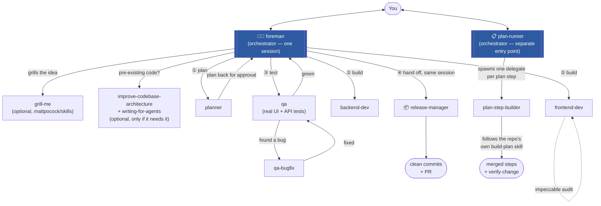
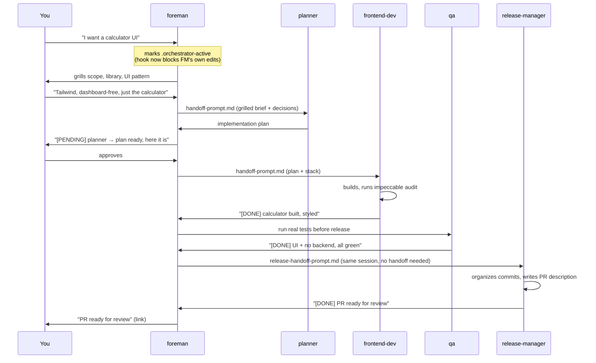

# foreman

🇺🇸 English | [🇧🇷 Português](README.pt-BR.md)

A Claude Code plugin of orchestrator skills that grill features and bugs with
you, run plans, and ship releases — by delegating every line of actual work
to dedicated sub-agents. None of them ever edit code or write a plan
themselves, same as a real foreman never swings the hammer.

## Why

Most "AI does my coding" setups collapse planning, building, testing and
shipping into one conversation with no separation of concerns — the same
session that argued with you about the feature is also the one writing it,
reviewing itself, and deciding it's done. Foreman splits that into roles with
real boundaries: an orchestrator that only decides and delegates, and
sub-agents that only build what they were told to build. A hook enforces the
boundary at the tool level, not just in the prompt.

## The fleet



`foreman` is the one session you open to go from idea to shipped PR — it
grills, plans, builds, tests and ships, all by delegating to agents in the
same session, never a second session of its own. `plan-runner` is a
separate entry point for when a plan already exists and is approved (from
`foreman`, or written by hand) and you just want it executed, step by step,
without opening a full `foreman` session for it:

| Skill | Role | Never does |
|---|---|---|
| `foreman` | Grills a new feature/bug with you, gathers context, delegates planning → building → testing → shipping, all in one session | Edit code, write the plan, decide it's done without `qa` saying so |
| `plan-runner` | Runs an *already-approved* plan step by step on repos that have their own plan/build tooling | Build a step itself, skip a step flagged "waiting on you" |

## A walkthrough



## Install

From wherever you keep local plugin sources:

```bash
git clone https://github.com/MTBasso/foreman
claude plugin marketplace add ./foreman
claude plugin install foreman@foreman-marketplace
```

Then start a **new** session (plugin skills load at session start) and run:

```
/foreman
```

New to foreman? [`examples/sandbox`](examples/sandbox) walks through trying
the whole flow once on a disposable empty project before pointing it at
something real.

## Updating

```bash
cd /path/to/foreman
git pull origin main
```

That's enough to get the new files — the plugin was installed pointing
straight at this folder, not a copy, so there's nothing to reinstall. For
the change to actually take effect in a session: if you only touched
docs/evals/non-loaded files (like this update), nothing else is needed.
If you changed a **skill, command, or agent**, either start a **new**
session, or run `/reload-plugins` in one that's already open — `claude
plugin marketplace add`/`install` do not need to run again.

## Usage

| Command | What it does |
|---|---|
| `/foreman [topic]` | Turn this session into the foreman orchestrator |
| `/foreman-status` | Show whether foreman mode is active and the project's recorded decisions |
| `/plan-runner <plan>` | Run an already-approved `docs/plans/<plan>.md` end to end |

There's no `/release-manager` command — it's a sub-agent `foreman` spawns
itself once a feature's waves are done, in the same session, not a session
you open directly.

`foreman` also installs its optional dependencies itself the first time it
runs (see below) — nothing to set up by hand.

## The guardrail, not just a prompt

While any orchestrator skill is active (`.orchestrator-active` exists at the
project root), a `PreToolUse` hook denies `Write`/`Edit`/`NotebookEdit`
outright — the one exception is the orchestrator's own `FOREMAN_MEMORY.md`
bookkeeping. "The orchestrator never touches code" is enforced at the tool
layer, not left to the model remembering a rule.

Every delegate agent (`frontend-dev`, `backend-dev`, `qa`, `qa-bugfix`,
`planner`, `plan-step-builder`) also carries a shared working-discipline
block: prefer the Edit tool over Bash line-splicing, self-check with the
project's own lint/build before reporting done, never claim something works
without having run it, stop after two failed attempts at the same fix
instead of looping, don't invent an API that was never confirmed to exist,
and never run a destructive command without explicit authorization.

## Contents

**Skills**
- `skills/foreman` — the main entry point (see above).
- `skills/plan-runner` — for repos with their own plan/build-step tooling
  (e.g. a `build-plan`/`plan-status`/`verify-change` setup). Deliberately
  skips re-validating the plan — that's what foreman's own grilling and
  your approval already did.
- `skills/design-preview` — renders real, library-backed HTML previews of UI
  options so design choices are picked by looking, not reading descriptions.
- `skills/project-memory` — reads/writes `FOREMAN_MEMORY.md`, the
  per-project record of stack choices, conventions and decisions, including
  the reasoning behind each one.

**Agents** (spawned by the orchestrators, never by you directly)
- `agents/planner.md` — turns a grilled brief into a plan. No code.
- `agents/frontend-dev.md` / `agents/backend-dev.md` — build to the plan and
  the stack already decided in `FOREMAN_MEMORY.md`.
- `agents/qa.md` — proactively runs real UI/API tests before any release
  handoff. Finds problems, never fixes them.
- `agents/qa-bugfix.md` — the reactive counterpart: fixes a specific failure
  handed to it by `qa`, CI, or a review comment.
- `agents/plan-step-builder.md` — builds and merges one `plan-runner` step by
  following the target repo's own `build-plan` skill exactly.
- `agents/release-manager.md` — packages finished waves into clean commits
  and a PR. Spawned by `foreman` directly, in the same session, once a
  feature's waves are done. Never implements features or fixes bugs.

**Commands**: `/foreman`, `/foreman-status`, `/plan-runner` — fast entry
points into the skills above.

**Hooks**: `hooks/hooks.json` + `hooks/block-edit-during-orchestrator.sh` —
the guardrail described above.

**Templates**
- `templates/handoff-prompt.md` — fixed shape for a delegation prompt, so
  decided context is pasted in directly instead of re-derived by the
  receiving agent.
- `templates/handoff-summary.md` — the `[PENDING]`/`[DONE]`/`[BLOCKED]`
  status-line format posted before/after every delegation.
- `templates/release-handoff-prompt.md` — what `foreman` hands to
  `release-manager` once a feature's waves are done.

**Evals**: `claude plugin eval .` runs formalized regression checks —
- an empty project halts and asks instead of guessing;
- the no-edit guardrail actually blocks an edit attempt, not just asked nicely to;
- an agent with Edit access prefers it over Bash line-splicing;
- `release-manager` gets spawned as an in-session sub-agent, not handed off
  to a new session.

## Optional dependencies

Four skills, from two other marketplaces, that `foreman` leans on when
they're installed and falls back to its own judgment on when they're not —
nothing breaks either way, you just lose that skill's specific approach.
`foreman` installs these itself the first time it runs if they're missing:

```bash
claude plugin marketplace add mattpocock/skills
claude plugin install grill-me@mattpocock/skills
claude plugin install improve-codebase-architecture@mattpocock/skills
claude plugin install writing-for-agents@mattpocock/skills
claude plugin marketplace add pbakaus/impeccable
# check the exact plugin id with `claude plugin list`, then e.g.:
claude plugin install impeccable@impeccable
```

- `grill-me` — the feature/bug interview.
- `improve-codebase-architecture` + `writing-for-agents` — run together, but
  only on a pre-existing codebase that actually looks like it needs the
  audit — not reflexively on every session.
- `impeccable` (by Paul Bakaus, not Matt Pocock) — audits/fixes generic "AI
  slop" styling. `frontend-dev` runs it on everything it builds; `qa` also
  runs it on older UI that predates this workflow.

## Troubleshooting

**A skill/command doesn't show up right after installing.** Plugin skills
load at session start. Finish any install/update, then start a genuinely
**new** session — don't keep using the one you ran `claude plugin install`
from.

**Not sure if foreman mode is actually active.** Run `/foreman-status` — it
prints whether `.orchestrator-active` exists and the current
`FOREMAN_MEMORY.md`, so you don't have to guess or open the file yourself.

**An edit got denied that you think shouldn't have been.** That's the
guardrail hook, not a crash. See "If the no-edit guardrail blocks something
it shouldn't" in `skills/foreman/SKILL.md` — in short: it's probably
genuine delegation-avoidance working as intended, but if it's a real false
positive, the fix is widening `hooks/block-edit-during-orchestrator.sh`'s
allowlist, not working around it per-session.

**Don't know the exact plugin id for `impeccable`.** Its marketplace name
can differ from `pbakaus/impeccable`, the repo name. After `claude plugin
marketplace add pbakaus/impeccable`, run `claude plugin list` and install
whatever id it actually registered.

**An optional dependency (`grill-me`, `impeccable`, etc.) failed to
install.** `foreman` tries once, tells you, and falls back to doing that
step itself without it — nothing blocks. Install it yourself later with the
commands under Optional dependencies, no need to restart anything.

**Want to try it without risking a real project.** See
[`examples/sandbox`](examples/sandbox).

## Acknowledgments

A lot of what shaped how this plugin thinks about agentic workflows came
from Matt Pocock's free [Dictionary of AI
Coding](https://github.com/mattpocock/dictionary-of-ai-coding) — it's worth
reading on its own. This plugin also runs several of his skills directly
(`grill-me`, `improve-codebase-architecture`, `writing-for-agents`), credited
in Optional dependencies above.
