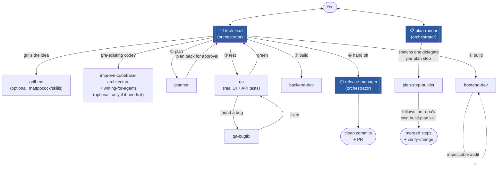
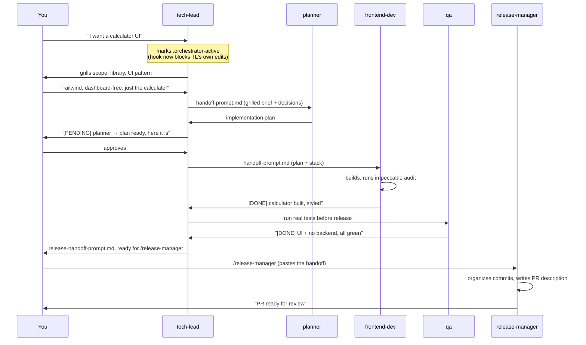

# foreman

A Claude Code plugin of orchestrator skills that grill features and bugs with
you, run plans, and ship releases — by delegating every line of actual work
to dedicated sub-agents. None of them ever edit code or write a plan
themselves, same as a real foreman never swings the hammer.

## Why

Most "AI does my coding" setups collapse planning, building, testing and
shipping into one conversation with no separation of concerns — the same
session that argued with you about the feature is also the one writing it,
reviewing itself, and deciding it's done. Foreman splits that into roles with
real boundaries: an orchestrator that only decides and delegates, and
sub-agents that only build what they were told to build. A hook enforces the
boundary at the tool level, not just in the prompt.

## The fleet



Three orchestrator skills, each its own session, each delegating instead of
implementing:

| Skill | Role | Never does |
|---|---|---|
| `tech-lead` | Grills a new feature/bug with you, gathers context, delegates planning → building → testing | Edit code, write the plan, decide it's done without `qa` saying so |
| `plan-runner` | Runs an *already-approved* plan step by step on repos that have their own plan/build tooling | Build a step itself, skip a step flagged "waiting on you" |
| `release-manager` | Packages finished waves into clean commits and a PR | Implement features, fix bugs |

## A walkthrough



## Install

From wherever you keep local plugin sources:

```bash
git clone https://github.com/MTBasso/foreman
claude plugin marketplace add ./foreman
claude plugin install foreman@foreman-marketplace
```

Then start a **new** session (plugin skills load at session start) and run:

```
/tech-lead
```

## Usage

| Command | What it does |
|---|---|
| `/tech-lead [topic]` | Turn this session into the tech-lead orchestrator |
| `/tech-lead-status` | Show whether tech-lead mode is active and the project's recorded decisions |
| `/plan-runner <plan>` | Run an already-approved `docs/plans/<plan>.md` end to end |
| `/release-manager` | Turn this session into the release manager, to package finished work |

`tech-lead` also installs its optional dependencies itself the first time it
runs (see below) — nothing to set up by hand.

## The guardrail, not just a prompt

While any orchestrator skill is active (`.orchestrator-active` exists at the
project root), a `PreToolUse` hook denies `Write`/`Edit`/`NotebookEdit`
outright — the one exception is the orchestrator's own `TECH_LEAD_MEMORY.md`
bookkeeping. "The orchestrator never touches code" is enforced at the tool
layer, not left to the model remembering a rule.

Every delegate agent (`frontend-dev`, `backend-dev`, `qa`, `qa-bugfix`,
`planner`, `plan-step-builder`) also carries a shared working-discipline
block: prefer the Edit tool over Bash line-splicing, self-check with the
project's own lint/build before reporting done, never claim something works
without having run it, stop after two failed attempts at the same fix
instead of looping, don't invent an API that was never confirmed to exist,
and never run a destructive command without explicit authorization.

## Contents

**Skills**
- `skills/tech-lead` — the main entry point (see above).
- `skills/plan-runner` — for repos with their own plan/build-step tooling
  (e.g. a `build-plan`/`plan-status`/`verify-change` setup). Deliberately
  skips re-validating the plan — that's what tech-lead's own grilling and
  your approval already did.
- `skills/release-manager` — packages finished waves into commits + a PR.
- `skills/design-preview` — renders real, library-backed HTML previews of UI
  options so design choices are picked by looking, not reading descriptions.
- `skills/project-memory` — reads/writes `TECH_LEAD_MEMORY.md`, the
  per-project record of stack choices, conventions and decisions, including
  the reasoning behind each one.

**Agents** (spawned by the orchestrators, never by you directly)
- `agents/planner.md` — turns a grilled brief into a plan. No code.
- `agents/frontend-dev.md` / `agents/backend-dev.md` — build to the plan and
  the stack already decided in `TECH_LEAD_MEMORY.md`.
- `agents/qa.md` — proactively runs real UI/API tests before any release
  handoff. Finds problems, never fixes them.
- `agents/qa-bugfix.md` — the reactive counterpart: fixes a specific failure
  handed to it by `qa`, CI, or a review comment.
- `agents/plan-step-builder.md` — builds and merges one `plan-runner` step by
  following the target repo's own `build-plan` skill exactly.

**Commands**: `/tech-lead`, `/tech-lead-status`, `/plan-runner`,
`/release-manager` — fast entry points into the skills above.

**Hooks**: `hooks/hooks.json` + `hooks/block-edit-during-orchestrator.sh` —
the guardrail described above.

**Templates**
- `templates/handoff-prompt.md` — fixed shape for a delegation prompt, so
  decided context is pasted in directly instead of re-derived by the
  receiving agent.
- `templates/handoff-summary.md` — the `[PENDING]`/`[DONE]`/`[BLOCKED]`
  status-line format posted before/after every delegation.
- `templates/release-handoff-prompt.md` — what `tech-lead` hands to
  `release-manager` once a feature's waves are done.

**Evals**: `claude plugin eval .` runs formalized regression checks — an
empty project halts and asks instead of guessing, and the no-edit guardrail
actually blocks an edit attempt rather than just being asked nicely to.

## Optional dependencies

Four skills, from two other marketplaces, that `tech-lead` leans on when
they're installed and falls back to its own judgment on when they're not —
nothing breaks either way, you just lose that skill's specific approach.
`tech-lead` installs these itself the first time it runs if they're missing:

```bash
claude plugin marketplace add mattpocock/skills
claude plugin install grill-me@mattpocock/skills
claude plugin install improve-codebase-architecture@mattpocock/skills
claude plugin install writing-for-agents@mattpocock/skills
claude plugin marketplace add pbakaus/impeccable
# check the exact plugin id with `claude plugin list`, then e.g.:
claude plugin install impeccable@impeccable
```

- `grill-me` — the feature/bug interview.
- `improve-codebase-architecture` + `writing-for-agents` — run together, but
  only on a pre-existing codebase that actually looks like it needs the
  audit — not reflexively on every session.
- `impeccable` (by Paul Bakaus, not Matt Pocock) — audits/fixes generic "AI
  slop" styling. `frontend-dev` runs it on everything it builds; `qa` also
  runs it on older UI that predates this workflow.
