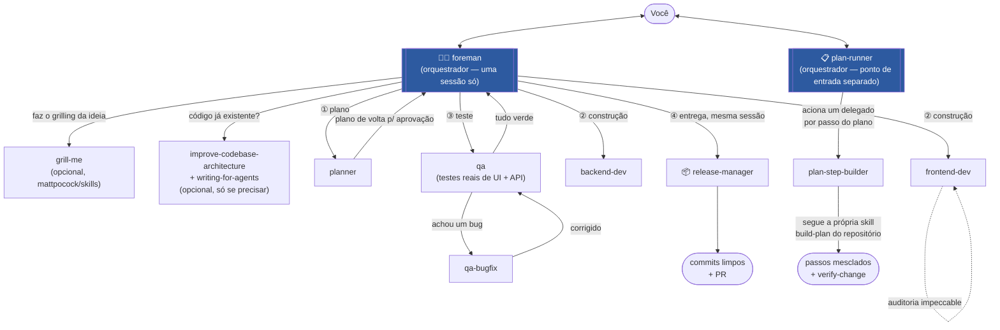
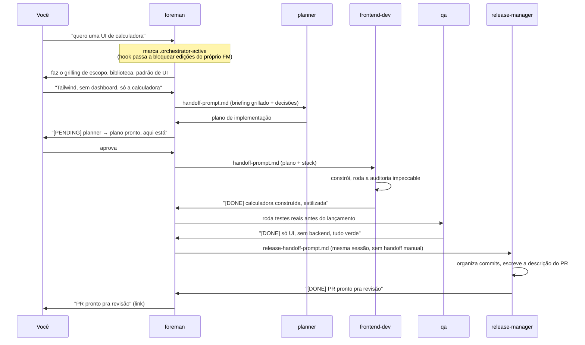

# foreman

[🇺🇸 English](README.md) | 🇧🇷 Português

Um plugin do Claude Code com skills orquestradoras que fazem o grilling de
features e bugs com você, executam planos, e lançam releases — delegando
cada linha de trabalho real pra sub-agentes dedicados. Nenhuma delas edita
código ou escreve um plano sozinha, assim como um foreman de verdade nunca
pega o martelo.

## Por quê

A maioria das configurações de "a IA programa por mim" junta planejamento,
construção, teste e lançamento numa única conversa, sem nenhuma separação de
responsabilidade — a mesma sessão que discutiu a feature com você é a mesma
que escreve o código, revisa o próprio trabalho, e decide sozinha que está
pronto. O foreman separa isso em papéis com fronteiras reais: um
orquestrador que só decide e delega, e sub-agentes que só constroem o que
foi pedido. Um hook reforça essa fronteira no nível da ferramenta, não só no
texto do prompt.

## A frota



O `foreman` é a única sessão que você abre pra ir da ideia até o PR
lançado — ele faz o grilling, planeja, constrói, testa e lança, tudo
delegando pra agentes dentro da mesma sessão, nunca abrindo uma segunda
sessão própria. O `plan-runner` é um ponto de entrada separado, pra quando
um plano já existe e já foi aprovado (vindo do `foreman`, ou escrito à mão)
e você só quer que ele seja executado, passo a passo, sem precisar abrir
uma sessão completa de `foreman` pra isso:

| Skill | Papel | Nunca faz |
|---|---|---|
| `foreman` | Faz o grilling de uma feature/bug nova com você, reúne contexto, delega planejamento → construção → teste → lançamento, tudo numa sessão só | Editar código, escrever o plano, decidir que terminou sem o `qa` confirmar |
| `plan-runner` | Executa um plano *já aprovado*, passo a passo, em repositórios que já têm suas próprias ferramentas de plano/build | Construir um passo sozinho, pular um passo marcado como "esperando você" |

## Um passo a passo



## Instalação

De onde você mantém suas fontes de plugin locais:

```bash
git clone https://github.com/MTBasso/foreman
claude plugin marketplace add ./foreman
claude plugin install foreman@foreman-marketplace
```

Depois abra uma sessão **nova** (as skills do plugin carregam no início da
sessão) e rode:

```
/foreman
```

## Uso

| Comando | O que faz |
|---|---|
| `/foreman [tópico]` | Transforma esta sessão no orquestrador foreman |
| `/foreman-status` | Mostra se o modo foreman está ativo e as decisões já registradas do projeto |
| `/plan-runner <plano>` | Executa um `docs/plans/<plano>.md` já aprovado, do início ao fim |

Não existe comando `/release-manager` — ele é um sub-agente que o próprio
`foreman` aciona sozinho, assim que as ondas de uma feature terminam, na
mesma sessão, não uma sessão que você abre diretamente.

O `foreman` também instala sozinho suas dependências opcionais na primeira
vez que roda (veja abaixo) — nada pra configurar à mão.

## O guardrail, não só um pedido no prompt

Enquanto qualquer skill orquestradora estiver ativa (o arquivo
`.orchestrator-active` existe na raiz do projeto), um hook `PreToolUse` nega
`Write`/`Edit`/`NotebookEdit` de cara — a única exceção é a própria
anotação de bookkeeping do `FOREMAN_MEMORY.md`. "O orquestrador nunca toca
em código" é reforçado no nível da ferramenta, não deixado só por conta do
modelo lembrar da regra.

Cada agente delegado (`frontend-dev`, `backend-dev`, `qa`, `qa-bugfix`,
`planner`, `plan-step-builder`) também carrega um bloco compartilhado de
disciplina de trabalho: preferir a ferramenta de edição em vez de recortar
linhas pelo Bash, se autoverificar com o lint/build do próprio projeto antes
de reportar concluído, nunca afirmar que algo funciona sem ter rodado de
verdade, parar depois de duas tentativas falhas da mesma correção em vez de
entrar em loop, não inventar uma API que nunca foi confirmada, e nunca
rodar um comando destrutivo sem autorização explícita.

## Conteúdo

**Skills**
- `skills/foreman` — o ponto de entrada principal (veja acima).
- `skills/plan-runner` — pra repositórios que já têm suas próprias
  ferramentas de plano/passo de build (ex: uma configuração de
  `build-plan`/`plan-status`/`verify-change`). Pula de propósito a
  revalidação do plano — isso já é feito pelo próprio grilling do foreman
  e pela sua aprovação.
- `skills/design-preview` — renderiza previews reais de HTML, com a
  biblioteca de verdade carregada, pra opções de UI serem escolhidas
  olhando, não lendo descrição.
- `skills/project-memory` — lê e escreve o `FOREMAN_MEMORY.md`, o
  registro por projeto de escolhas de stack, convenções e decisões,
  incluindo o raciocínio por trás de cada uma.

**Agentes** (acionados pelos orquestradores, nunca diretamente por você)
- `agents/planner.md` — transforma um briefing grillado num plano. Sem código.
- `agents/frontend-dev.md` / `agents/backend-dev.md` — constroem seguindo o
  plano e a stack já decididos no `FOREMAN_MEMORY.md`.
- `agents/qa.md` — roda testes reais de UI/API proativamente antes de
  qualquer entrega de release. Encontra problemas, nunca os corrige.
- `agents/qa-bugfix.md` — a contraparte reativa: corrige uma falha
  específica entregue por ele pelo `qa`, pela CI, ou por um comentário de
  revisão.
- `agents/plan-step-builder.md` — constrói e mescla um passo do
  `plan-runner`, seguindo a própria skill `build-plan` do repositório alvo.
- `agents/release-manager.md` — empacota ondas terminadas em commits limpos
  e um PR. Acionado pelo `foreman` diretamente, na mesma sessão, assim que
  as ondas de uma feature terminam. Nunca implementa feature nem corrige bug.

**Comandos**: `/foreman`, `/foreman-status`, `/plan-runner` — atalhos de
entrada pras skills acima.

**Hooks**: `hooks/hooks.json` + `hooks/block-edit-during-orchestrator.sh` —
o guardrail descrito acima.

**Templates**
- `templates/handoff-prompt.md` — formato fixo de um prompt de delegação,
  pra contexto já decidido ser colado diretamente em vez de redescoberto
  pelo agente que recebe.
- `templates/handoff-summary.md` — o formato de linha de status
  `[PENDING]`/`[DONE]`/`[BLOCKED]` postado antes e depois de cada delegação.
- `templates/release-handoff-prompt.md` — o que o `foreman` entrega ao
  `release-manager` assim que as ondas de uma feature terminam.

**Evals**: `claude plugin eval .` roda verificações de regressão
formalizadas — um projeto vazio para e pergunta em vez de adivinhar, e o
guardrail de não-edição realmente bloqueia uma tentativa de edição em vez de
só pedir educadamente.

## Dependências opcionais

Quatro skills, de dois marketplaces diferentes, que o `foreman` usa quando
estão instaladas e cai no próprio julgamento quando não estão — nada quebra
de qualquer jeito, você só perde a abordagem específica daquela skill. O
`foreman` instala elas sozinho na primeira vez que roda, se estiverem
faltando:

```bash
claude plugin marketplace add mattpocock/skills
claude plugin install grill-me@mattpocock/skills
claude plugin install improve-codebase-architecture@mattpocock/skills
claude plugin install writing-for-agents@mattpocock/skills
claude plugin marketplace add pbakaus/impeccable
# confira o id exato do plugin com `claude plugin list`, depois algo como:
claude plugin install impeccable@impeccable
```

- `grill-me` — a entrevista de feature/bug.
- `improve-codebase-architecture` + `writing-for-agents` — rodam juntas, mas
  só numa base de código já existente que realmente parece precisar da
  auditoria — não de forma reflexiva em toda sessão.
- `impeccable` (de Paul Bakaus, não de Matt Pocock) — audita e corrige
  estilização genérica de "AI slop". O `frontend-dev` roda em tudo que
  constrói; o `qa` também roda em UI mais antiga, anterior a esse fluxo.

## Agradecimentos

Boa parte de como este plugin pensa fluxos de trabalho com agentes veio do
[Dictionary of AI
Coding](https://github.com/mattpocock/dictionary-of-ai-coding), conteúdo
gratuito de Matt Pocock — vale muito a leitura por conta própria. Esse
plugin também roda várias das skills dele diretamente (`grill-me`,
`improve-codebase-architecture`, `writing-for-agents`), creditadas em
Dependências opcionais acima.
