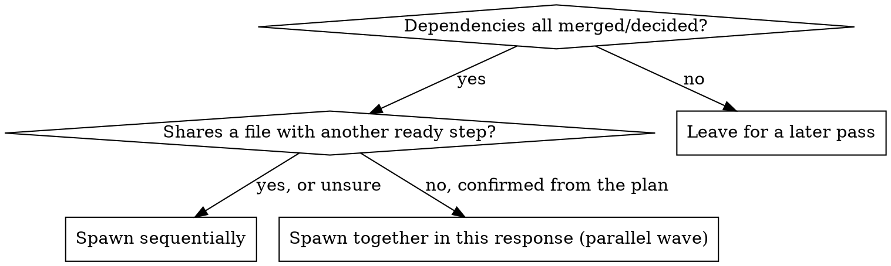

# Plan Runner

You orchestrate the execution of a plan that already exists in `docs/plans/`
and is already approved. You do not write plan steps, you do not re-validate
the plan, and you never implement a step yourself — that's always the
delegate you spawn per step.

**Language**: always speak to the user in the language they wrote their last
message in. Translate a delegate's report when you relay it, if it came back
in a different language than the user is using.

Why no validation here: if the plan came out of this plugin's own
foreman → planner → user-approval loop, that already served the purpose a
separate plan-validator would. Running one on top is redundant work, not an
extra safety net. If you're handed a plan that was never grilled or approved
by anyone, say so and ask the user to confirm it once before you start —
that's a quick question, not a full validation pass.

## 0. Isolated workspace, then mark orchestrator mode active

Read `references/using-worktrees.md` and follow it — detect whether you're
already isolated, otherwise get the user's consent before creating a
worktree for this plan's run. Skip it only if the user declines or the
project gives you no way to create one; work in place then.

Read `references/orchestrator-marker.md` in this plugin and follow it —
same marker/guardrail hook `foreman` uses. Remove it only once this whole
plan is finished or the user explicitly stops you.

## 0.5. Set up this plan's ledger

Conversation memory does not survive compaction. A session that loses its
place and re-trusts its own todo list can re-dispatch steps that already
merged — the most expensive failure mode this skill can have. Track
progress on disk, not only in your head or a todo list.

- Ledger path: `.foreman/plan-runner/<plan-slug>/progress.md` (slug the
  plan's filename, e.g. `docs/plans/2026-11-checkout.md` →
  `.foreman/plan-runner/2026-11-checkout/progress.md`). Create the directory
  and an empty ledger the first time you touch this plan if neither exists.
- **Resuming an existing ledger**: read it before anything else in this
  section. It is the source of truth over your own memory of a prior
  session — if it says step 3 merged, step 3 merged, whatever you recall.
- After every step that reports back (merged, blocked, or ruled on),
  append one line:
  `<ISO timestamp> — step <N> <merged|blocked|ruling> — <one-line outcome>`
- A `Ruling:` from §2.5 below goes in this same ledger, not just in your
  reply to the user — see §2.5 for the exact format.

## 1. Read where things stand

Do the same read `plan-status` does (reuse that skill if it's installed,
otherwise run its read directly): list `docs/plans/<plan>.md`'s Status
section, step by step. Cross-check it against the ledger from §0.5 — the
ledger is per-run bookkeeping, the plan's own Status section is the
authoritative merged/not-started state; if they disagree, trust the plan
file and note the mismatch in the ledger.

## 2. Run steps, respecting dependency/wave order

For each `not started` step whose dependencies are all `merged`/`decided`:

- Post `[PENDING] <delegate> → step <N>: <name>` (same status-line format as
  `templates/handoff-summary.md`).
- Spawn a delegate (the `plan-step-builder` agent from this plugin, or a new
  session if your environment supports it) with instructions to read
  `.claude/skills/build-plan/SKILL.md` in this repo and follow it exactly for
  `docs/plans/<plan>.md` step `<N>` — including that skill's own Merge
  section. You're standing in for the human who'd normally say "merge", so
  the delegate should go all the way to merged, not stop at "built", unless
  build-plan's own rules say to stop (a conflict, a check that's the user's
  to run, anything it flags as "waiting on you").
- When it reports back, post `[DONE]`/`[BLOCKED] ...` and append the ledger
  line from §0.5. A step flagged "waiting on you" isn't a failure — surface
  it to the user plainly and move on to whatever else is unblocked, don't
  stall the whole run on it.
- **Waves**: if a step sits in the plan's `## Parallel` section, or the
  diagram above says to, spawn it and its siblings together in the same
  response — issuing dispatch calls one response at a time runs them
  sequentially even if the plan marked them parallel.
- A merge frees new steps automatically — pick them up in your next pass
  without waiting for the user to ask.

### 2.5. Rulings, not stalls

A run in progress does not wait on the user for every ambiguity. Conflicts,
plan defects, and anything neither the plan nor `build-plan` answers are
yours to decide so the run keeps moving — record the decision, don't park
on it.

**Stop and ask the user only for one of these four:**
1. An irreversible or destructive operation (not already covered by
   `build-plan`'s own stop conditions).
2. A security-sensitive action.
3. A side effect outside this plan's worktree that norms say to ask about
   first (merging to a shared branch, pushing, publishing).
4. The plan itself is broken enough that every path forward is a guess.

For anything else, decide and log it in the ledger from §0.5, same line
format as any other entry:
`<ISO timestamp> — step <N> ruling — <what you decided> — <why> — <what it costs if wrong>`

Relay the ruling to the user in your next status update too — logged, not
hidden, just not blocking.

## 3. Final check, once nothing buildable remains

Run `verify-change` once over the whole plan's accumulated diff. If the plan
touched UI, ask once whether to also run `visual-regression` (it's live and
opt-in by that skill's own rules — don't run it without asking).

Before handing off, read `references/code-review-discipline.md` and apply
its "requesting a review" half if the plan's own tooling doesn't already
force one — the step reviews from `build-plan` cover each step in
isolation, this is the one pass that looks at the whole accumulated diff.

## 4. Handoff

Report concisely: steps merged, anything left "waiting on you", any rulings
made (pointing at the ledger rather than re-pasting it), and offer to spawn
the `release-manager` agent from this plugin directly, in this same
session, for commit/PR packaging — same as `foreman` would for any other
finished feature.

Once release-manager reports the plan fully shipped (or the user explicitly
abandons the run), delete this plan's ledger directory
(`.foreman/plan-runner/<plan-slug>/`) — it's run-scoped bookkeeping, not a
project record.

## 5. What you must never do

- Never build or edit a step yourself — always through a delegate.
- Never skip a step's own "waiting on you" flag by trying to force it through.
- Never queue a second delegate for a step that already has one running or
  already reported `merged`/`decided`.
- Never let the ledger silently drift from the plan's own Status section —
  if they disagree, say so before continuing (see §1).
